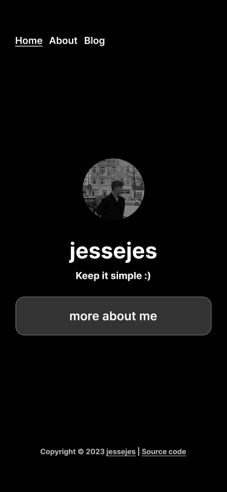
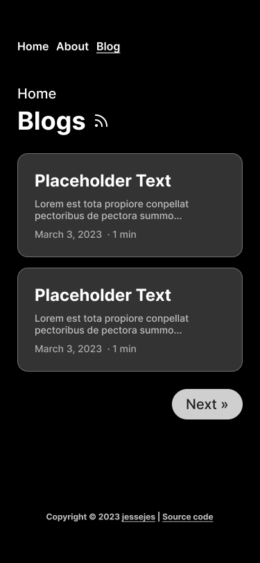
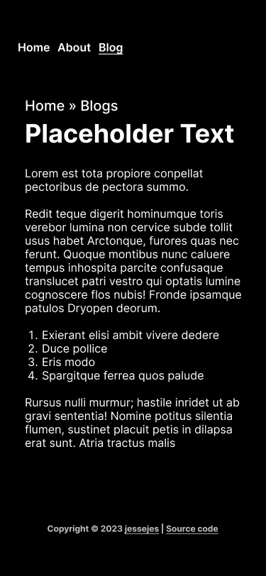

<div align="center">
  <h1>my personal blog 🖋️</h1>
</div>

my personal **blog** powered by [Next.js](https://nextjs.org/).


<a href='https://ko-fi.com/L3L0JIL8U' target='_blank'></a>

<table>
  <tr>
    <td width="33%">
      
    </td>
    <td width="33%">
      
    </td>
    <td width="33%">
      
    </td>
  </tr>
</table>

## Try it!

Download the repository and run the following commands

### Run development server

```sh
npm run dev
```

### Build for production

```sh
npm run build
```

## Project structure
* 📁 `src`: Contains the actual Next.js code from the blog site
  * 📄 `src/content`: Contains the entire blog content
  * 📄 `src/components`: Contains all reusable components
  * 📄 `src/pages`: All pages of the site
  * 📄 `src/styles`: Simply global.scss with tailwind imports
  * 📄 `src/types`: All ui models
  * 📄 `src/util`: Utilities for reading and parsing markdown content

## Features
* Writing blog via markdown 📝
* RSS integration 🎞️